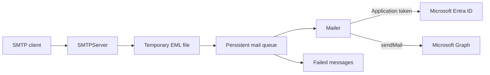

# Architecture

SMTP2Graph accepts SMTP messages and relays them through Microsoft Graph to Microsoft 365 / Exchange Online. It is a TypeScript application bundled by webpack for Node.js.

## Message flow

1. `src/server.ts` validates configuration, creates the queue, and starts the SMTP server.
2. `SMTPServer` applies configured connection, authentication, sender, rate, size, and storage limits. It writes accepted messages to a temporary EML file and enqueues them before returning SMTP success.
3. `MailQueue` watches queued EML files and passes them to `Mailer`. Successful sends are removed; permanent failures and messages that exhaust configured retries move to `failed`. Retry scheduling is held in memory.
4. `Mailer` acquires an application token through MSAL and sends MIME content to the Microsoft Graph `users/{sender}/sendMail` endpoint. It retries selected throttling and service errors. `MsalProxy` supports the configured HTTP proxy for authentication.

An SMTP success confirms durable local enqueueing, not final delivery by Microsoft 365. Queue files can contain message content and require suitable storage protection and retention.

## Configuration and operation

`config.yml` is loaded from the working directory by default; `--config=...` selects another file. See `config.example.yml` and `config.schema.json` for settings. Application registration credentials or a certificate are required for sending. Protect configuration, certificates, logs, and mail storage as appropriate for their contents.

The `full` mode receives and sends; `receive` only queues messages; `send` processes the queue without accepting SMTP messages. The configured storage root defaults to `mailroot`, with `temp`, `queue`, and `failed` directories. Logs are written to the console and files under `logs`.

The Docker image runs as UID/GID 65532, uses `/data` as its working directory and volume, expects `/data/config.yml`, and listens on port 587. Persist the configured queue storage and make it writable by the container user.

## Build and delivery

`npm run build` creates `dist/server.js`, which the Dockerfile copies into a Node 20 Alpine image. `scripts/ci-validate.sh` installs dependencies, builds, runs receive tests, and checks workflow policy. Graph send tests require separate Microsoft 365 test configuration; see `test/readme.md`.

`.github/workflows/release-ci.yml` delegates pull request validation, development image publication, and version-tag release publication to the shared CI/CD workflow. Branch pushes that change only Markdown files do not trigger this workflow; pull requests remain validated, and version tags continue to trigger releases. Deployment is disabled in this repository's workflow.
